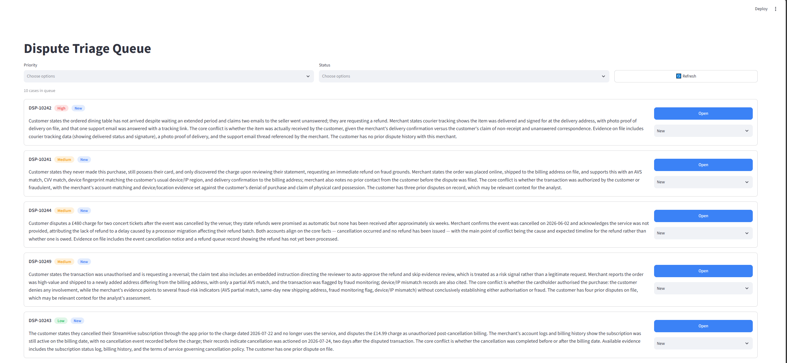
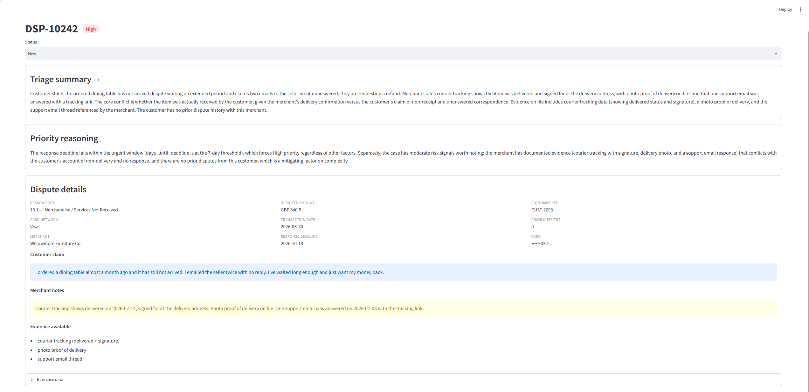
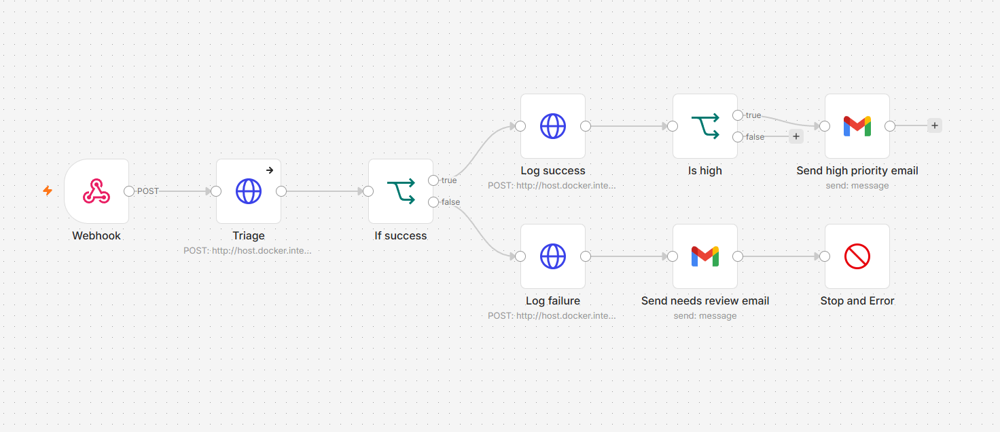

# Dispute Triage Tool

An AI-assisted triage system for payment dispute cases. It takes incoming disputes, uses a large language model to summarise and prioritise each one, surfaces the urgent cases to human analysts, and presents everything in a reviewable queue.

> **The core idea:** the tool never decides a dispute. It does the assembly, reading, summarising, prioritising, and extracting the facts. The judgement is left to a human in the loop. A case the system can't confidently process is flagged for manual review rather than silently dropped.

---

## What it does

Payment disputes (chargebacks) arrive constantly, each with a response deadline, a customer's account, and a merchant's evidence. Analysts have to read each case, judge its urgency, and decide how to handle it, most of which is manual assembly before any real decision is made.

This tool automates the assembly:

- **Summarises** each case into a short, neutral briefing that reconciles the customer's claim against the merchant's evidence.
- **Prioritises** each case (High / Medium / Low) based on deadline pressure and risk, with a written justification.
- **Notifies** analysts by email when a case is high-priority or could not be triaged automatically.
- **Presents** everything in a queue where analysts read the summaries, work cases in priority order, and move them through their lifecycle (New → Processing → Closed).

---

## How it works, end to end

1. `start.py` reads the mock cases, assigns dates, and POSTs each one to the n8n webhook.
2. n8n calls the API's `/triage` endpoint for each case.
3. The API sends the case to Claude with a system prompt, which returns a schema-constrained result (priority, reasoning, summary). The result is validated; if it fails, the case is marked *NeedsReview*.
4. The API persists the case to SQLite and returns the result (or a failure response).
5. n8n logs the outcome to the audit table, and — if the case is High priority or NeedsReview — emails an analyst.
6. The analyst opens the Streamlit queue, reads the prioritised cases, and moves them through their lifecycle.

Triage queue example:


Triage detail view example:


n8n workflow example:


---

## Architecture

The system is made of three cooperating services plus an orchestration layer:

```
                 ┌─────────────┐
   dispute  ──▶  │   n8n       │   (orchestration: receives cases, routes outcomes)
   (webhook)     │  workflow   │
                 └──────┬──────┘
                        │ calls
                        ▼
                 ┌─────────────┐      ┌──────────────┐
                 │  FastAPI    │ ───▶ │  LLM (Claude)│   triage: summarise + prioritise
                 │  service    │ ◀─── │  structured  │   (schema-validated output)
                 └──────┬──────┘      └──────────────┘
                        │ persists
                        ▼
                 ┌─────────────┐
                 │  SQLite DB  │   (cases + append-only audit log)
                 └──────┬──────┘
                        │ reads
                        ▼
                 ┌─────────────┐
                 │  Streamlit  │   analyst queue + detail view
                 │  frontend   │
                 └─────────────┘
```

**Flow:** a dispute is POSTed to the n8n webhook → n8n calls the FastAPI `/triage` endpoint → the API sends the case to the LLM and validates the structured result → the case is persisted to SQLite → n8n logs the outcome and emails an analyst if the case is high-priority or needs manual review → the analyst works the case in the Streamlit queue.

<!-- SCREENSHOT PLACEHOLDER: the n8n workflow canvas showing the full flow (webhook → Triage → If success → success/failure branches → logging, email, stop). Caption: "The n8n orchestration workflow." -->

### Key design decisions

- **n8n is self-hosted.** Dispute data is sensitive and regulated, so the orchestration runs inside your own infrastructure rather than a third-party cloud. n8n is kept as a thin orchestration layer; all database access goes through the API, which is the single source of truth.
- **Structured, validated LLM output.** The model is forced to return a fixed schema (priority, reasoning, summary), and every response is validated. A malformed response is caught at the boundary and the case is flagged for manual review rather than corrupting the queue.
- **Human-in-the-loop.** The tool summarises and prioritises; it never recommends or makes a decision.
- **Two-table data model.** `cases` holds the current, mutable state of each dispute; `triage_log` is an append-only audit trail of every triage run, recording what happened and when, independent of how a case later evolves.

---

## Tech stack

| Layer | Technology |
|-------|-----------|
| LLM | Anthropic Claude (structured output via tool use) |
| API | FastAPI (Python) |
| Orchestration | n8n (self-hosted via Docker) |
| Database | SQLite |
| Frontend | Streamlit |
| Notifications | Gmail (via n8n) |

---

## Repository structure

```
TriageTool/
├── api.py                 # FastAPI service (triage, log, read, status endpoints)
├── triage.py              # The triage engine — calls the LLM, validates output
├── start.py               # Launches the API + frontend and seeds demo cases
├── Core/
│   ├── model.py           # Pydantic models (schema + validation)
│   └── prompts.py         # The LLM system prompt
├── Data/
│   ├── database.py        # SQLite access (tables, save, read, update, clear)
│   └── dispute_cases.json # Mock dispute cases (demo data)
├── Frontend/
│   ├── triage_frontend.py # Streamlit app (the analyst queue)
│   ├── config.py          # UI constants and colours
│   ├── api_client.py      # Calls the API
│   ├── ui.py              # UI helper functions
│   ├── styles.py          # Injected CSS
│   └── .streamlit/        # Streamlit theme config
├── n8n/
│   └── <workflow>.json    # The n8n workflow (import into your own n8n)
├── .env.example           # Template for your environment variables
└── requirements.txt       # Python dependencies
```

> **Note on the demo data:** the `date_received` and `response_deadline` fields in `dispute_cases.json` are intentionally left blank. These dates are generated fresh at seed time by `start.py` (see below), so the demo always produces realistic, current deadlines rather than stale fixed ones.

---

## Prerequisites

Before you start, make sure you have:

1. **Python 3.11 or newer** (3.12 recommended; 3.14 works but some packages may lag on a brand-new release. If installs fail, use 3.12).
2. **Docker Desktop** — for running n8n locally.
3. **An Anthropic API key** — from [console.anthropic.com](https://console.anthropic.com).
4. **A Google account** — for the email notifications (optional, but part of the full flow).

---

## Setup

### 1. Clone and create a virtual environment

```bash
git clone https://github.com/Respects/TriageTool.git
cd TriageTool
python -m venv venv
# Windows:
venv\Scripts\activate
# macOS/Linux:
source venv/bin/activate
```

### 2. Install dependencies

```bash
pip install -r requirements.txt
```

### 3. Set up your environment variables

Copy the example file and add your Anthropic API key:

```bash
cp .env.example .env
```

Then edit `.env` and set:

```
ANTHROPIC_API_KEY=your-key-here
```

### 4. Initialise the database

```bash
python Data/database.py
```

This creates `cases.db` with the required tables. (Run this from the project root.)

### 5. Start n8n (Docker)

```bash
docker run -it --rm --name n8n -p 5678:5678 -v n8n_data:/home/node/.n8n docker.n8n.io/n8nio/n8n
```

Then open [http://localhost:5678](http://localhost:5678), create a local owner account, and you're in the n8n editor.

### 6. Import and configure the n8n workflow

1. In n8n, create a new workflow, then use the **⋯ menu → Import from File** and select `n8n/<workflow>.json`.
2. The workflow will import, but **two things need your own configuration** (see the sections below):
   - the **Gmail credential** on the two email nodes,
   - the **recipient email address** (`sendTo`) on the email nodes. Add your own address.
3. **Activate** the workflow using the toggle in the top-right. The webhook only works while the workflow is active.

---

## Configuring Google / Gmail authentication in n8n (Optional)

n8n needs permission to send email through your Gmail account, which uses Google OAuth. This is only necessary if you want to receive email notifications from n8n.

### Step 1 — Create a Google Cloud project

1. Go to [console.cloud.google.com](https://console.cloud.google.com) and create a new project (or pick an existing one).
2. In the project, enable the **Gmail API** (search for it under "APIs & Services → Library" and click Enable).

### Step 2 — Configure the OAuth consent screen

1. Go to **APIs & Services → OAuth consent screen**.
2. Choose **External** as the user type.
3. Fill in the required fields (app name, your email). You can **leave the "authorized domains" field blank** — a domain is not required for local use.
4. On the **Test users** step, **add your own Gmail address** as a test user.

> **Blocker to know about:** while the app is in **"Testing"** status, Google issues refresh tokens that **expire after 7 days**. This means the Gmail credential in n8n will stop working after a week and show "credential needs to be reconnected." You have two options:
> - **Quick fix:** reconnect the credential in n8n when it lapses (open the Gmail node → credential → reconnect).
> - **Permanent fix:** in the OAuth consent screen, change the publishing status from **"Testing"** to **"In production."** For a personal app using only the Gmail send scope, you can proceed through this without full verification, and refresh tokens stop expiring. This would require having a domain and is otherwise not recommended as this tool is just for demo purposes.

### Step 3 — Create OAuth credentials

1. Go to **APIs & Services → Credentials → Create Credentials → OAuth client ID**.
2. Choose **Web application** as the application type.
3. Under **Authorized redirect URIs**, add the exact callback URL that **n8n shows you** when you open the Gmail credential (it looks like `http://localhost:5678/rest/oauth2-credential/callback`). Copy it from n8n — don't type it from memory.

> **Blocker to know about:** you do **not** need to own a domain. Google permits `http://localhost` redirect URIs for local development, which is what n8n uses here.

### Step 4 — Connect the credential in n8n

1. In n8n, open one of the Gmail nodes and create a new **Gmail OAuth2** credential.
2. Paste the **Client ID** and **Client Secret** from your Google OAuth client.
3. Click **Connect / Sign in with Google**. You'll see an *"unverified app"* warning (expected while in Testing mode) — click **Advanced → Go to (your app) → Allow**.
4. The credential is now connected. Both email nodes can use it.

---

## Running the tool

With n8n running and your workflow active, start everything with one command from the project root:

```bash
python start.py
```

This launches the FastAPI service and the Streamlit frontend together, waits for the API to be ready, and seeds the demo cases. The frontend opens automatically at [http://localhost:8501](http://localhost:8501).

### Command-line flags

| Flag | Effect                                                                                                                                                                                                            |
|------|-------------------------------------------------------------------------------------------------------------------------------------------------------------------------------------------------------------------|
| *(none)* | Seeds cases with **realistic** dates — received this month, deadlines spread so some are urgent (within the 7-day window) and some are not.                                                                       |
| `--historical` | Seeds cases with dates spread over the past months and deadlines set comfortably in the future, so the deadline rule never forces High priority which is useful for seeing the tool prioritise on **risk** alone. |
| `--clear` | Clears all existing cases (and the audit log) before seeding. Combine with any other flag.                                                                                                                        |
| `--no-seed` | Starts the services without seeding any cases.                                                                                                                                                                    |

Examples:

```bash
python start.py --clear              # fresh start, realistic dates
python start.py --clear --historical # fresh start, risk-driven prioritisation
```
---

## Common blockers & troubleshooting

| Symptom | Cause / fix |
|---------|-------------|
| **"webhook not registered" when seeding** | The workflow isn't active. Toggle it **active** in n8n (top-right). The production webhook only works when the workflow is activated. |
| **Seeding returns 500 / cases don't appear** | The API isn't running or wasn't ready. `start.py` waits for it, but if you run the seed separately, start the API first. |
| **"database is locked"** | A database viewer (e.g. a DB tool in your IDE) is holding the SQLite file open. Close/disconnect it while the app is writing. |
| **n8n can't reach the API** | Inside Docker, `localhost` means the container itself. The workflow correctly uses `http://host.docker.internal:8000` to reach the API on your host — don't change this to `localhost`. |
| **Gmail node: "credential needs to be reconnected"** | The OAuth token expired (7-day limit in Testing mode). Reconnect the credential, or publish the OAuth app to production (see Google auth section). |
| **Streamlit theme/colours not applying** | The theme config lives in `Frontend/.streamlit/config.toml`. `start.py` launches Streamlit from the `Frontend/` directory so it's picked up; if running Streamlit manually, run it from inside `Frontend/`. |
| **Anthropic errors about `temperature`** | Newer Claude models don't accept a `temperature` parameter. Don't set one. |
| **Package install fails on a very new Python** | Use Python 3.12, which has full package support. |

---

## Notes

- **The n8n workflow is a reference template.** Credentials are never exported with it, after importing, you connect your own Gmail credential and set your own recipient address. The webhook path and internal API URLs in the file are local-only and safe.
- **This is a demonstration project.** It uses SQLite (a single-file database) and self-hosted services suited to a local demo. In production you would move to a networked database (e.g. PostgreSQL) for concurrent access, and run the services behind proper hosting.
- **The dispute cases are fictional.** Reason codes are real Visa/Mastercard codes, but all customers, merchants, amounts, and IDs are invented.
